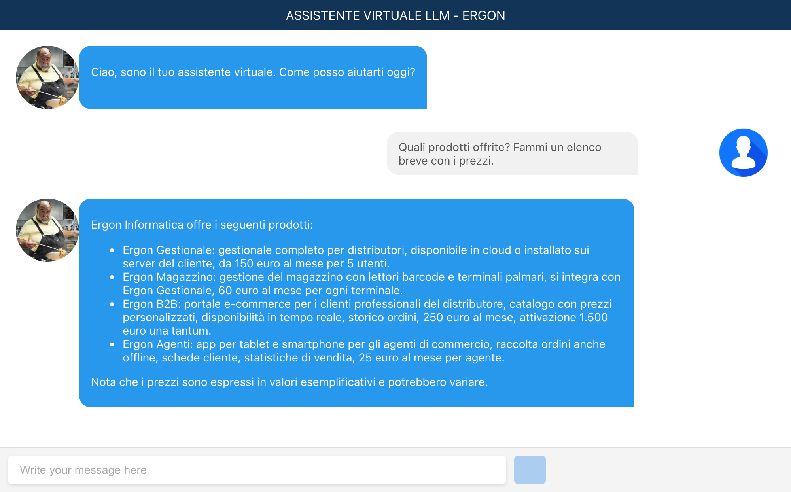
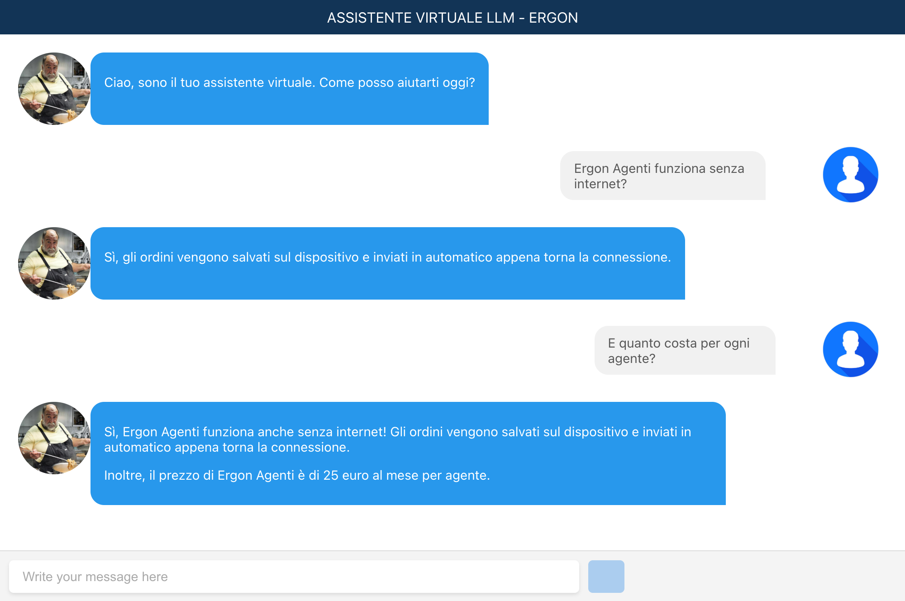

# Chatbot RAG

Assistente virtuale che risponde alle domande sull'azienda **Ergon Informatica** usando i documenti aziendali (tecnica RAG, *Retrieval-Augmented Generation*).

> ⚠️ **I dati sono inventati.**
> I documenti in [`backend-py/demo_data/`](backend-py/demo_data/) sono di esempio e servono solo per provare l'app.
> Prodotti, prezzi, contatti e regole sono di fantasia e **non sono informazioni reali su Ergon Informatica**.

<p align="center">
  
  
</p>

*Screenshot della demo con Ollama (`llama3`): a sinistra una domanda sui prodotti, a destra una domanda di approfondimento che usa la cronologia della chat.*

## Come funziona

L'app è composta da tre servizi:

| Servizio | Porta | Cosa fa |
|---|---|---|
| **frontend** (React) | 3000 | L'interfaccia della chat |
| **llm_server** (Python) | 5002 | Riceve le domande, recupera i documenti utili e genera la risposta con l'LLM |
| **rag_server** (Python) | 5001 | Tiene i documenti in un database vettoriale (FAISS) e trova i pezzi più simili alla domanda |

Quando fai una domanda, il server LLM chiede al server RAG i 4 pezzi di documento più pertinenti e li passa al modello come contesto per rispondere.

## ⚠️ Prima di avviare: serve un modello (LLM)

Il chatbot ha bisogno di un modello linguistico. Scegli **una** delle due opzioni e scrivila nel file **`.env`** nella cartella principale del progetto (lo crei al passo 2 qui sotto).

### Opzione A: OpenAI (chiave API, a pagamento)

Risposte di qualità migliore. Serve una chiave API di OpenAI, da creare su https://platform.openai.com/api-keys (con un minimo di credito prepagato; per una demo il costo è di pochi centesimi).

Nel file `.env`:

```env
LLM_PROVIDER=openai
OPENAI_API_KEY=sk-...la-tua-chiave...
```

### Opzione B: Ollama (gratis, in locale)

Nessuna chiave e nessun costo: il modello gira sul tuo computer. Le risposte sono più lente e meno precise, ma vanno bene per provare la demo.

1. Installa Ollama da https://ollama.com/download e avvialo.
2. Scarica i due modelli usati di default (circa 2,3 GB in totale):
    ```bash
    ollama pull llama3.2:3b
    ollama pull nomic-embed-text
    ```
3. Nel file `.env`:
    ```env
    LLM_PROVIDER=ollama
    ```

I container Docker si collegano in automatico all'Ollama in esecuzione sul tuo computer.

### Usare un modello diverso

Con lo stesso provider puoi scegliere altri modelli, sempre nel `.env`:

```env
LLM_MODEL=gpt-4o          # oppure ad es. qwen2.5:7b con Ollama
EMBEDDING_MODEL=text-embedding-3-large
```

Per aggiungere un altro fornitore (Gemini, Claude, Mistral…) basta modificare un solo file: [`backend-py/src/providers.py`](backend-py/src/providers.py).

## Avvio con Docker (un solo comando)

Serve [Docker Desktop](https://www.docker.com/products/docker-desktop/).

1. Clona il repository:
    ```bash
    git clone https://github.com/matthewpan98/chatbot-rag.git
    cd chatbot-rag
    ```
2. Crea il file `.env` partendo dall'esempio e completalo con l'opzione A o B scelta sopra:
    ```bash
    cp .env.example .env
    ```
3. Avvia tutto:
    ```bash
    docker compose up --build
    ```
4. Apri **http://localhost:3000** e prova a chiedere, per esempio:
    - "Quanto costa Ergon B2B?"
    - "Ergon Agenti funziona senza internet?"
    - "Come posso disdire il contratto?"

Per fermare tutto: `docker compose down`.

Al primo avvio il server RAG legge i documenti demo e li salva in `backend-py/database/vector_store/`. Dagli avvii successivi li ricarica da lì. Se cambi modello di embedding, il database viene ricreato in automatico.

## Usare documenti propri

1. Metti i tuoi file `.txt` o `.pdf` in `backend-py/demo_data/` (oppure in un'altra cartella indicata con `DATA_DIR` nel `.env`).
2. Cancella la cartella `backend-py/database/vector_store`.
3. Riavvia con `docker compose up --build`.

## Struttura del progetto

- **frontend-react/**: frontend in React
- **backend-py/**: server LLM e RAG in Python
- **backend-py/src/providers.py**: scelta del modello (OpenAI, Ollama…)
- **backend-py/demo_data/**: documenti di esempio (dati inventati)
- **docker-compose.yml**: avvia tutti i servizi insieme
- **.env.example**: modello del file di configurazione

## Avvio senza Docker

Segui i README nelle cartelle [`frontend-react`](frontend-react/README.md) e [`backend-py`](backend-py/README.MD).

## Licenza

Questo progetto è distribuito sotto la GNU General Public License, Versione 3, 29 Giugno 2007.
Per maggiori dettagli, consulta il file [LICENSE](LICENSE.txt).
